# 3D OBJ Explorer for Apple IIGS

**A Tribute to Robert DONY**  
*Author of "Calcul des parties cachées", Masson, 1986*

A 3D model viewer and explorer implementing multiple painter's algorithms, specifically designed for the Apple IIGS computer using ORCA/C and the QuickDraw graphics API.

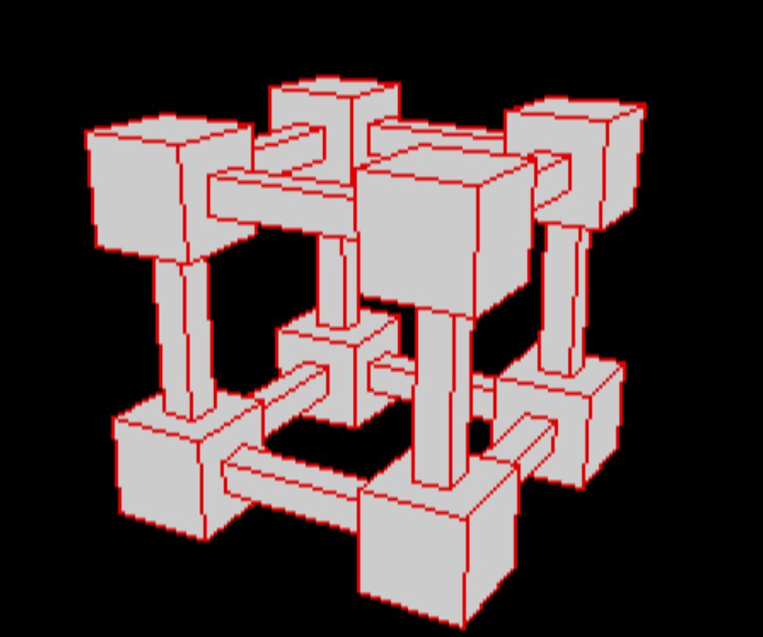

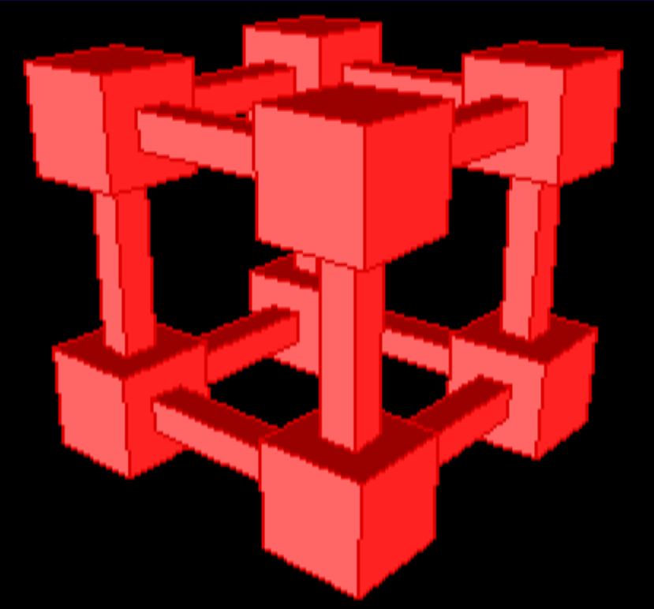
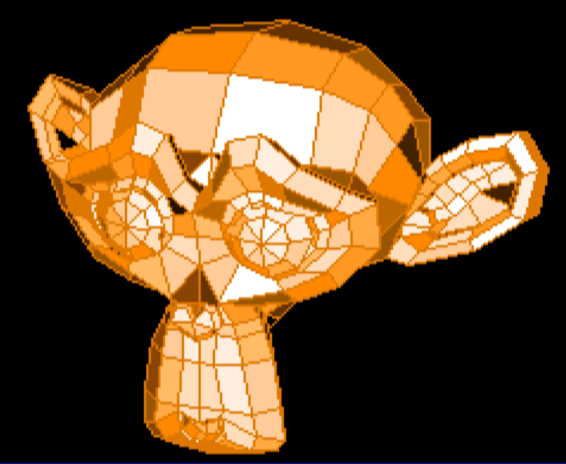
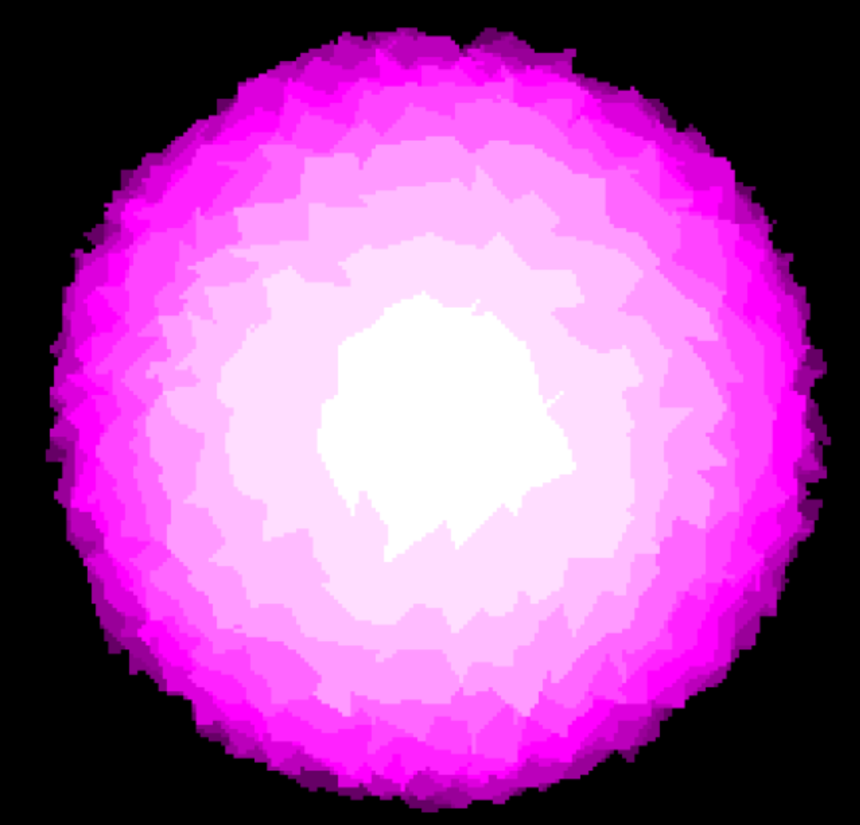

## Overview

3D Explorer is an interactive 3D rendering application that reads simplified Wavefront OBJ files and displays them with manipulation capabilities. The project demonstrates advanced rendering techniques on resource-constrained hardware (Apple IIGS with 2.8 MHz 65C816 CPU and 1 Mb) through careful optimization and multiple algorithm implementations. It performs satisfactorily on a modern computer and in emulation mode, due to the large number of calculations it requires.

It is built around the painter's algorithm: faces are sorted and drawn back-to-front so that nearer polygons naturally occlude farther ones. The application includes several painter variants, from fast z-mean ordering to more robust geometric correction passes for overlapping and intersecting faces. Visibility can also be resolved per pixel with a scanline Z-buffer, a full-screen offscreen Z-buffer, or a full-screen renderer writing directly to the display. The three paths share their depth-test and pixel-output assembly kernel.

## Getting Started

1. **Load a model**: Run the program and enter the path to a simplified OBJ file when prompted. You can omit '.obj' at the end of the filename; the program will add it for you. Answer the optional intersection-check prompt, then press `Enter` at each camera prompt to accept the horizontal angle, vertical angle, screen rotation, and suggested auto-fit distance. Those defaults can still be changed later through the application controls.
2. **Now you see the 3D object centred on the screen**
3. **Use the controls**: Navigate the scene with the keyboard and switch rendering modes using keys `1` through `7`.
4. **Change the color palette**: Press `G` to cycle through the available color palettes.
5. **Choose colors**: Press `>` to choose the fill color and `<` to choose the frame color, from an on-screen color chooser.
6. **Enable orientation shading**: Press `!` to toggle orientation-based shading on and off.
7. **Inspect faces**: Press `V` to inspect a single face, then press `Space` to view detailed face information. Use `V` (in that detail screen) to reverse the vertex winding of the selected face and update its front/back classification, `H`/`R`/`A` to hide, restore, or restore all faces, and `N` (in the main face viewer) to toggle display of the face's normal.
8. **Inspect face pairs**: Press `Q` to inspect a pair of faces, navigate between pairs, diagnose ordering anomalies, and use `R` to move the currently earlier face later in the draw order or `E` to move the currently later face earlier. These are manual ordering changes, not guaranteed geometric corrections.
9. **Get full help**: Press `H` to display the complete keyboard help screen and command summary.
10. **Repair ordering**: Press `;` to review overlapping face pairs and accept or skip each correction proposed by the same core used by GEO V3.
11. **Use Z-buffer rendering**: Press `O` for scanline rendering, `U` for full-screen offscreen rendering, or `Open-Apple + U` for direct full-screen rendering.

12. **Animate a rotation**: Press `/`, choose the number of views allowed by available memory, then precompute and loop a horizontal turn. Right/Up speeds up playback, Left/Down slows it down, and any other key stops; any key cancels preparation between frames; your original view is restored.

### Why use this explorer/viewer?

- It is optimized for the Apple IIGS hardware and demonstrates fixed-point 3D rendering techniques.
- It includes advanced painter algorithms for difficult overlapping geometry.
- It provides a scanline Z-buffer rendering
- It provides a full-screen 16-bit Z-buffer rendering, with offscreen and direct-screen output paths
- It provides interactive inspection and debugging tools for face order, overlap, and visibility issues.

## Limitations 
However, it has many limitations, including: speed (requires an accelerator or emulator), the number of vertices and faces, the number of vertices per face, very limited handling of intersecting faces, and handling of the case of cyclic overlap by the Z-buffer renderers only (scanline or full-screen), not by any painter mode.
Example : 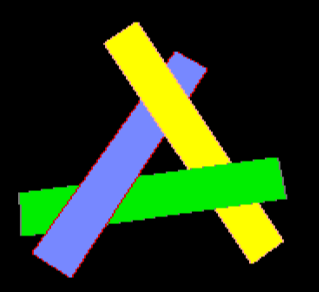
This image couldn't have been generated with painters as they are implemented here. But either Z-buffer renderer (scanline, triggered by 'O' key, or full-screen triggered by 'U' key) resolves it correctly.

### Quick start keys

- `H`: show full help screens
- `1`: FAST mode
- `2`: BUBBLE SORT mode
- `3`: NEWELL SANCHA mode
- `4`: GEO mode
- `5`: GEO V3 mode
- `6`: CORRECT mode
- `7`: CORRECT V2 mode
- `O`: optimized scanline Z-buffer mode
- `U`: optimized full-screen Z-buffer mode using the offscreen framebuffer
- `Open-Apple + U`: optimized full-screen Z-buffer mode rendered directly onscreen
- `/`: precompute and loop a small horizontal rotation; arrows adjust speed, other keys stop
- `8`: enable random fill colors and regenerate random color arrays; preserve the frame-color selection
- `>`: choose fill color (interactive color chooser)
- `<`: choose frame color, including "same as fill color" = no separate border (interactive color chooser)
- `9`: reset colors to defaults, restore palette 0, and disable orientation shading
- `B`: toggle back-face culling
- `P`: toggle wireframe (frame-only) rendering
- `C`: toggle palette display overlay
- `G`: cycle through available color palettes
- `!`: toggle orientation-based shading
- `V`: inspect a face, arrow to navigate, 'space' for options (record face data in a file, revert vertex order)
- `Q`: inspect a face pair and navigate between pairs
- `;`: repair face order

### Key Features

- **Seven Painter Modes**: FAST, BUBBLE SORT, NEWELL SANCHA, GEO, GEO V3, CORRECT, and CORRECT V2 offer different ordering strategies. None splits faces during sorting, so intersecting polygons and cyclic visibility can remain unresolved.
- **Three Z-Buffer Paths**: Scanline, full-screen offscreen, and full-screen direct output share a 65C816 span kernel and resolve visibility per pixel.
- **3D Manipulation**: Camera distance, three rotation angles, perspective scale, and screen panning.
- **Inspection and Repair**: Single-face viewer, directional S/D inspection, pair diagnostics, and an interactive repair based on GEO V3.
- **Fixed-Point Arithmetic**: Signed 16.16 coordinates with 64-bit intermediate calculations where required.
- **Shared Infrastructure**: Ordering caches, geometric relations, inspection-state preservation, screen clearing, and Z-buffer preparation reduce duplicated code.

## Technical Architecture

### Graphics Pipeline

1. **Model Loading**: Parse simplified OBJ vertices and faces, swap the imported Y/Z axes, center the bounding box, and prepare auto-fit suggestions. An optional experimental intersection/splitting pass runs at load time.
2. **3D Transformation**: Apply camera rotations and distance to obtain observer-space coordinates.
3. **Projection and Metrics**: Project vertices; compute face depths, observer-space planes, projected bounds, and visibility flags.
4. **Face Sorting**: Run the selected painter mode and store its draw-order permutation.
5. **Rasterization**: Draw polygons through QuickDraw, or invoke a Z-buffer renderer on the prepared view. Z-buffer visibility does not depend on the painter permutation.

### Rendering Modes

#### FAST Mode (Key: `1`)

- `painter_newell_sancha_fast` sorts faces by decreasing mean depth using `qsort`.
- Face ID provides a deterministic tie-break; no polygon-overlap or plane-side correction is performed.
- Useful as a simple baseline, but average depth alone cannot resolve many overlapping faces.

#### BUBBLE SORT Mode (Key: `2`)

- `painter_bubble_sort` corrects adjacent face pairs through bubble-sort passes.
- Cheap depth/bounding-box checks precede geometric face-relation tests in both directions.
- Inconclusive cases can use projected polygon overlap and hierarchical ray casting.
- It remains a face-order heuristic, with bounded processing rather than a guarantee for arbitrary geometry.

#### NEWELL SANCHA Mode (Key: `3`)

- `painter_newell_sancha` combines candidate filtering and stable insertion of faces in the draw order.
- Its shared geometric machinery includes:
  1. Depth and projected bounding-box rejection.
  2. Sweep-based candidate preparation to avoid unrelated pairs.
  3. Cached geometric relations evaluated in both directions.
  4. Projected polygon-overlap checks when geometry is inconclusive.
  5. Hierarchical ray casting for remaining ordering decisions.
  6. Stable moves with inverse-position updates and bounded correction work.
- Fixed-point coordinates and wider intermediates are used where needed. Intersections and cyclic overlaps may still prevent a valid whole-face order.

#### GEO Mode (Key: `4`) — ⚠️ CAN BE VERY SLOW ON LARGE MODELS

- `painter_geoV2` uses neighboring-pair correction passes, a pair cache, and bounded iteration.
- Geometric tests are supplemented by overlap checks and hierarchical ray casting when necessary.
- Runtime depends on geometry, overlap density, and correction count; compare it with the other modes on your own models.

#### GEO V3 Mode (Key: `5`) — ⚠️ CAN BE VERY SLOW ON LARGE MODELS

- `painter_geoV3` delegates to the shared `geov3_run` core.
- Normal sorting starts from canonical face IDs and a stable maximum-depth ordering, then filters candidate pairs with C/assembly helpers.
- Geometric relations, cached polygon overlap, and hierarchical ray casting guide exchanges. Stamps and iteration limits bound repeated work. Every exchange, including one decided directly by the plane tests, requires overlap confirmed by the selected method. This prevents adjacent split fragments from creating false exchange cycles; sorting and repair use the same filter.
- The interactive repair reuses this core, but starts from the current order and asks before applying exchanges.
- This mode does not split faces; cyclic visibility and intersecting polygons can remain unresolved. Runtime is model-dependent.

#### CORRECT Mode (Key: `6`)

- `painter_correct(model, face_count, 0)` starts with FAST mean-depth ordering.
- A stable partition separates BACK (`plane_d <= 0`) and FRONT (`plane_d > 0`) faces.
- Local insertions correct the FRONT group using shared geometric relations.
- This is a correction heuristic, not a full Newell-Sancha pass or a general intersection solver.

#### CORRECT V2 Mode (Key: `7`)

- `painter_correct(model, face_count, 1)` uses the same implementation as CORRECT, with additional correction stages.
- When back-face culling is off, it also corrects the BACK group and checks ordering across the BACK/FRONT partition.
- Cross-group decisions use geometric tests and a mean-depth fallback where required.
- The two modes share code while preserving their different correction policies; neither guarantees a valid order for every model.

#### Scanline Z-Buffer Mode (Key: `O`)
- Alternative renderer, entirely separate from the painter's-algorithm pipeline: visibility is resolved per pixel rather than by sorting complete faces
- Rasterizes polygons scanline by scanline and uses even-odd span pairing, so concave faces are handled without special-casing
- Uses a **single 320-entry 16-bit depth buffer**, reused for every scanline (about 640 bytes of depth-buffer storage)
- Reciprocal depth (`1/z`) is prepared and quantized to a 16-bit depth representation; the hot span loop avoids per-pixel floating-point operations
- Edge/span interpolation and the Z-test are optimized for the 65C816; span rendering performs depth testing, Z-buffer updates and direct SHGR pixel writes without a C call for each visible pixel
- Prepared vertices/faces, reciprocal-depth quantization, and scanline/offscreen edge helpers are shared where their contracts match
- Face fill and border colors follow the same user settings as the painter renderer (default/manual colors, orientation shading and random colors)
- Back-face culling is honored; when culling is disabled, the renderer uses the corresponding biased path to reduce coplanar Z-fighting
- **Memory**: 640 bytes describes only the depth line; prepared faces, vertices, edges, and other scratch buffers require additional storage. Performance depends on the model and target machine

#### Full-Screen Z-Buffer Mode (Key: `U`, or `Open-Apple + U`)
- Alternative renderer, also independent of painter face ordering, using a persistent **320x200 16-bit depth buffer** for the complete frame
- Depth uses the optimized 16-bit reciprocal-depth encoding (smaller stored value = closer, `0xFFFF` = empty/infinitely far), with the quantization scale adapted to the current frame
- The full-screen depth buffer is cleared once per frame and retained for all scanlines
- Span rendering is optimized for the 65C816 and performs the per-pixel depth test/update together with direct pixel output
- Back-face culling selects the fast or biased rendering path as appropriate
- **`U`**: clears the offscreen framebuffer, calls `renderModelFullscreenZBuffer_offscreen(model)`, then copies the completed image to SHGR with `Offscreen_FlushToScreen()`
- **`Open-Apple + U`**: calls `renderModelFullscreenZBuffer(model)` and renders directly to the SHGR screen instead of using the offscreen framebuffer
- Direct rendering derives reciprocal-depth gradients from the existing observer-space Newell plane, rather than fitting quantized depths to rounded screen vertices. This avoids unstable depth slopes on thin projected faces; surfaces and outlines use the same plane. Common coefficient scaling cancels in the plane ratios; projection reciprocals and depth bias are prepared once per frame, leaving one floating-point division per face
- Direct-renderer outlines use `ZBuffer_EdgeRun`, a 65C816 kernel that advances Bresenham, depth values, and far pixel/depth pointers without per-pixel C calls. The original clipping, depth-equality, and geometric edge-visibility rules are retained
- Vertex preparation computes reciprocal depth directly from 16.16 values and finds the maximum using fixed-point comparisons. Direct outlines avoid initial clipping divisions when the first point is visible on the major axis and use 16-bit depth quotients/remainders. Offscreen rendering skips unused interpolation divisions for two-pixel or constant-depth spans, writes bridge pixels without an extra helper call, and clears RAM in blocks of sixteen words. The separate quality rules of both renderers are retained; target timing is still required.
- Direct fill advances each face depth plane by addition between scanlines. The shared span kernel writes a complete packed byte when both interior pixels pass the strict depth test, while preserving hidden nibbles otherwise. These changes retain the separate direct and preview/offscreen rendering rules; target timings are required to assess the speedup.
- **Memory**: the full depth buffer requires 128,000 bytes; offscreen output adds a 32,000-byte pixel buffer, in addition to preparation and scratch storage. Rendering speed must be measured on the target machine
- All three renderers use `ZBuffer_SpanRun` in `zbuffer_common.c` for the depth test and packed-pixel output. Preparation, storage, edge handling, and output destination still differ; equal-depth fragments do not replace the existing pixel

Press `/` to precompute a full horizontal rotation using the direct Z-buffer renderer and the current colors, shading, culling, vertical angle, and screen rotation. The temporary capture is a centered rectangle fitted to the model’s projected proportions over the entire horizontal turn. Forty candidate widths (multiples of eight, up to 320 pixels) compete under a 164-line height limit and a 28,160-pixel area budget; the best uniform scale retains two pixels of safety margin. This avoids constraining wide models to a square. For `models/a` at default parameters, the chosen capture is 224 × 124: the H=30° model is about 189 × 83 pixels, reduced from the previous 214 × 94 to ease visible sweeping. The graphics screen shows `Arrows: up/right +, down/left -` at the bottom, outside the captured/transferred area. More pixels may change between frames. The original view, scale, pan, visibility and face ordering are restored afterward. Preparation reports every frame and transition on the text screen through Text Tools, with the text output device explicitly restored while QuickDraw remains active; any key cancels between frames. Playback loops until a key other than an arrow is pressed.

Before precomputation, the text screen asks for an even frame count between **4 and the maximum actually allocated** (up to 60), allowing a conservative 128 KiB reserve after renderer allocation. Keyboard input uses the existing hardware key reader with explicit Text Tools echo, independent of stdin: Backspace/Delete edits the last character, Enter validates, and Escape cancels. The input screen is cleared first and Text Tools lines use explicit CR/LF separators to avoid overwriting preceding messages. The standard `Number of views [maximum]:` prompt defaults to that memory-derived maximum; press Enter to accept it, or enter 0 to cancel. There is no fixed 12-view default. Invalid counts are rejected, and unused handles are released immediately. If fewer than four views can be reserved, an explanatory message waits for a keypress before returning to the original view. A complete image needs at most 14080 bytes; each transition reserves at most 49354 bytes, with actual reservations computed from the chosen rectangle of executable code. Transition compilation compares 16-bit words in one pass using advancing pointers and video addresses, skipping every unchanged word while retaining erasures. This replaces a redundant bounding-box scan and emits identical 65C816 immediate loads and direct video stores. The initial render used to allocate renderer scratch storage is reused as view zero, eliminating one complete rendering pass per command. The initial image assumes a cleared black screen and writes only nonblack words, while still hidden behind the text screen. Pixel copies are freed before playback. Up to eight blocks of 96 words are applied per refresh, rather than one block per refresh. Each transition takes at least two VBLs; changes exceeding 768 words can still span several refreshes. No geometry is computed during playback. Each completed view initially stays visible for `ANIM_VIEW_TICKS=12` ticks (0.2 seconds), regardless of the number of frames. During playback, Right/Up decreases the hold by one tick, Left/Down increases it, within 1 to 120 ticks; changes take effect during the current wait without recomputation. Each new animation resets the hold to 12 ticks. Transfer time is additional; no fixed total rotation duration is imposed. Other keys interrupt the hold and stop playback. The chosen delay is printed during preparation. The larger capture uses more memory and can reduce the selected frame count. The keyboard/VBL assembly explicitly restores 16-bit assembler mode before returning to C, so ORCA encodes the C epilogue with the correct operand widths. Playback is tied to the video refresh, so changing the emulated CPU speed does not change its rate while each block completes in time. This is not an atomic screen-page flip; target testing is required to assess smoothness. The transfer strategy follows the change-list approach discussed in [Apple IIGS Technical Note 70](https://apple2.gs/technotes/tn-iigs-070/).

### Mathematical Implementation

**Fixed-Point Arithmetic:**
```c
#define FIXED_SHIFT 16
#define FIXED_SCALE (1L << FIXED_SHIFT)  // 65536
typedef long Fixed32;    // 16.16 format
typedef int64_t Fixed64; // wider intermediate; scaling depends on the operation
```

**3D Transformations:**
- Rotation matrices use 360-entry sine/cosine tables with 1° precision
- Imported coordinates are centered before rendering; camera rotations and distance produce observer coordinates `(xo, yo, zo)`. Screen rotation provides the third view angle
- Perspective projection: `x2d = 160 + (xo * scale / zo)`, `y2d = 100 - (yo * scale / zo)`

**Plane Equations:**
For each face, compute plane coefficients (a, b, c, d) where:
- `ax + by + cz + d = 0`
- `calculateFaceDepths` computes observer-space normals using **Newell's method** over the complete contour. This supports concave planar faces better than a cross product of the first three vertices; degenerate or non-planar contours still require care.
- `compute_face_plane` separately computes an object-space plane from the first three vertices, with explicit raw-fixed or object-unit coordinate modes. These coefficients do not have interchangeable scales.
- `geometric_face_relation` uses a distance-adapted tolerance; other overlap and ray tests retain their own numeric contracts.
- Used for sidedness tests in painter algorithm

### Front Faces and Back Faces

Face orientation is determined in observer space, after the model has been transformed relative to the camera.
- A face is considered **front-facing** when its plane equation constant `d` is positive in observer space.
- A face is considered **back-facing** when `d <= 0`.
- The sign of `d` depends on the face normal direction relative to the camera, not just the original OBJ winding order.
- Reversing the vertex order of a face flips its normal and therefore changes whether it is classified as front or back.

In the application, the `showFace` inspector (command `V`) reports this directly using `faces->plane_d[target_face]`:
- `plane_d > 0` => `FRONT`
- `plane_d <= 0` => `BACK`

### Back-Face Culling

Observer-space culling eliminates faces oriented away from the viewer:
- Test: `d <= 0` (where d is the plane equation constant in observer space)
- Visibility flags suppress back faces during rendering; participation in sorting depends on the selected algorithm
- Toggle at runtime with `B` key

### Performance Optimizations

1. **Preprocessor Directives**: #pragma optimize 1

2. **Precomputed Tables**: Sine/cosine tables avoid runtime trigonometric calculations. Auto-fit reuses the fixed-point multiplication kernel and cancels the shared 16.16 scale in projection ratios, avoiding four floating-point divisions per projected vertex while retaining the existing progress display. The isolated auto-fit benchmark measured a 45–47% reduction in calculation time; its reference calculation and test driver are now archived as disabled code in `old/chutier.c`

3. **Buffer Reuse**: Persistent polygon handles and memory buffers reduce allocations

4. **Shared Kernels and Caches**: Candidate filtering, cached pair/overlap results, fixed-point assembly helpers, and a common Z-buffer span kernel avoid repeated work

The batch CSV benchmark of the ten rendering methods has been archived as disabled code in `old/chutier.c`, together with its 50 KiB limit and repetition settings. It is no longer compiled or mapped to a key. Existing CSV files and analysis reports remain available. The six-method projected-overlap benchmark, its private helper and its former `/` benchmark command are also archived in `old/chutier.c`; the overlap algorithms remain available through `(`.

## User Guide

### Getting Started

1. **Launch Application**: Run `3D Explorer` from your Apple IIGS
2. **Enter Filename**: Type the OBJ filename when prompted (or press ENTER to exit)
3. **Model Loads**: The application parses vertices and faces, applies auto-fit if available
4. **Intersection Check**: Asks whether to perform an intersection check. Answering yes runs a validation pass that check 3D intersections and attempt limited in-memory splitting before rendering. This experimental pass does not solve every intersection and is separate from projected-overlap tests used by sorting and inspection. The crossing count and strict-interior verdict now share one plane/projection and edge scan per direction, retaining their separate boundary rules.
5. **Set Camera Parameters**: Confirm or modify observer settings:
   - **Horizontal Angle**: Rotation around vertical axis in degrees (ENTER for default 30°)
   - **Vertical Angle**: Rotation around horizontal axis in degrees (ENTER for default 20°)
   - **Screen Rotation**: Rotation around screen Z-axis in degrees (ENTER for default 0°)
   - **Distance**: Camera distance from model origin (ENTER accepts default/auto-fit value)
6. **View Model**: The 3D model renders with your camera configuration

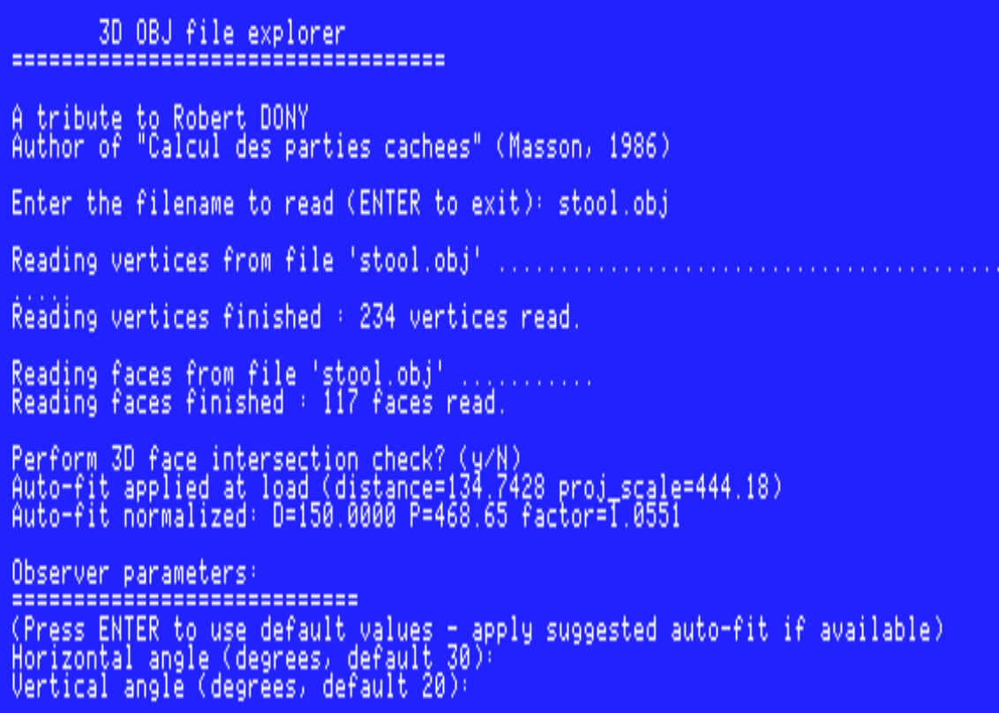
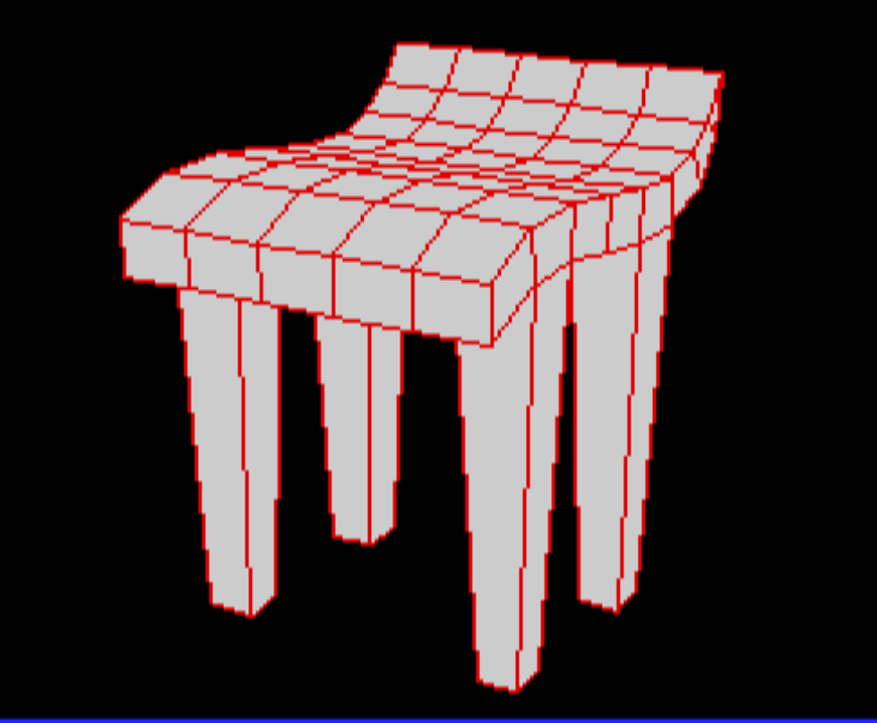

### Keyboard Controls Reference

#### Camera Movement
| Key | Action | Description |
|-----|--------|-------------|
| `A` / `Z` | Distance | Move camera closer/farther by 10%; with Open-Apple, change distance by 50% |
| `Left` / `Right` | Horizontal Rotation | Rotate camera 10 degrees around vertical axis (1 degree with Open-Apple key) |
| `Up` / `Down` | Vertical Rotation | Rotate camera 10 degrees around horizontal axis (1 degree with Open-Apple key) |
| `W` / `X` | Screen Rotation | Rotate view 10 degrees around screen Z-axis (1 degree with Open-Apple key) |
| `+` / `-` | Projection Scale | Increase/decrease perspective scaling (±10%) |
| `K` | Edit Parameters | Manually enter camera distance and angles |

#### View Controls
| Key | Action | Description |
|-----|--------|-------------|
| `E` / `R` | Pan Left/Right | 2D screen offset by 10 pixels; 1 pixel with Open-Apple |
| `T` / `Y` | Pan Up/Down | 2D screen offset by 10 pixels; 1 pixel with Open-Apple |
| `0` | Reset Pan | Return to center position (0, 0) |
| `C` | Toggle Colors | Show/hide color palette |
| `J` | Toggle Jitter | Toggle stylized rendering that applies a random per-vertex 2D offset (0..10 px) |
| `P` | Wireframe Mode | Toggle between filled and frame-only polygons |
| `B` | Back-Face Culling | Enable/disable observer-space culling |
| `G` | Cycle Palette | Cycle through the 16 available SHGR color palettes |
| `!` | Orientation Shading | Toggle orientation-based flat shading on/off |


#### Rendering Modes
| Key | Mode          | Algorithm/Description |
|-----|---------------|----------------------|
| `1` | FAST          | Simple Z-mean sorting without geometric correction |
| `2` | BUBBLE SORT   | Adjacent-pair correction through bubble-sort passes |
| `3` | NEWELL SANCHA | Candidate-filtered geometric ordering with stable insertions |
| `4` | GEO           | Cached geometric neighbor corrections with overlap/ray fallback |
| `5` | GEO V3        | Shared geometric exchange engine, without face splitting |
| `6` | CORRECT       | Advanced ordering correction (homebrew implementation) |
| `7` | CORRECT V2    | Shared CORRECT engine with additional BACK/cross-group correction |
| `O` | SCANLINE Z-BUFFER | Optimized 16-bit Z-buffer renderer using a single 320-pixel depth line |
| `U` | FULLSCREEN Z-BUFFER | Optimized full-screen Z-buffer rendered through the offscreen framebuffer, then copied to SHGR |
| `Open-Apple + U` | FULLSCREEN Z-BUFFER (ONSCREEN) | Optimized full-screen Z-buffer rendered directly to SHGR |
| `/` | PRECOMPUTED ROTATION | Horizontal rotation loop; Right/Up faster, Left/Down slower; other keys stop; any key cancels preparation |

#### Color Management
| Key | Action | Description |
|-----|--------|-------------|
| `8` | Random Colors (quick) | Enable random fill and regenerate random color arrays; preserve the frame-color selection |
| `>` | Choose Fill Color | Opens the interactive color chooser to select the interior color (0-15) or random mode |
| `<` | Choose Frame Color | Opens the interactive color chooser to select the outline color (0-15), random mode, or "same as fill" (no separate border) |
| `9` | Reset Colors | Restore default colors (fill=light gray/14, frame=red/7), reset palette to 0, and disable orientation shading |

**Interactive Color Chooser (`>` / `<` keys):**

Pressing `>` or `<` opens an on-screen color picker over a black background:
- Displays the 16 colors of the current SHGR palette as numbered squares (0-15), plus a "Random" square and, for the frame chooser only, a "Same as fill" square.
- `Up` / `Down` arrows cycle through the 16 available color palettes; the picker updates instantly to show the new palette's colors.
- `Left` / `Right` arrows move the selection between color squares (highlighted with a white border).
- Any other key confirms the current selection and closes the picker.


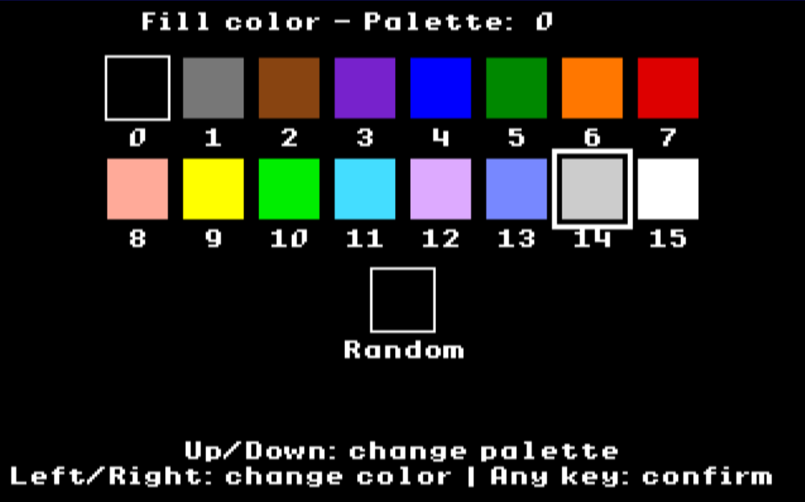
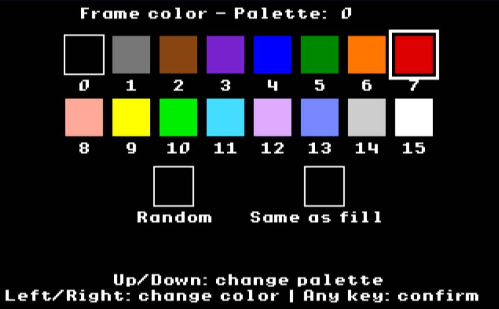
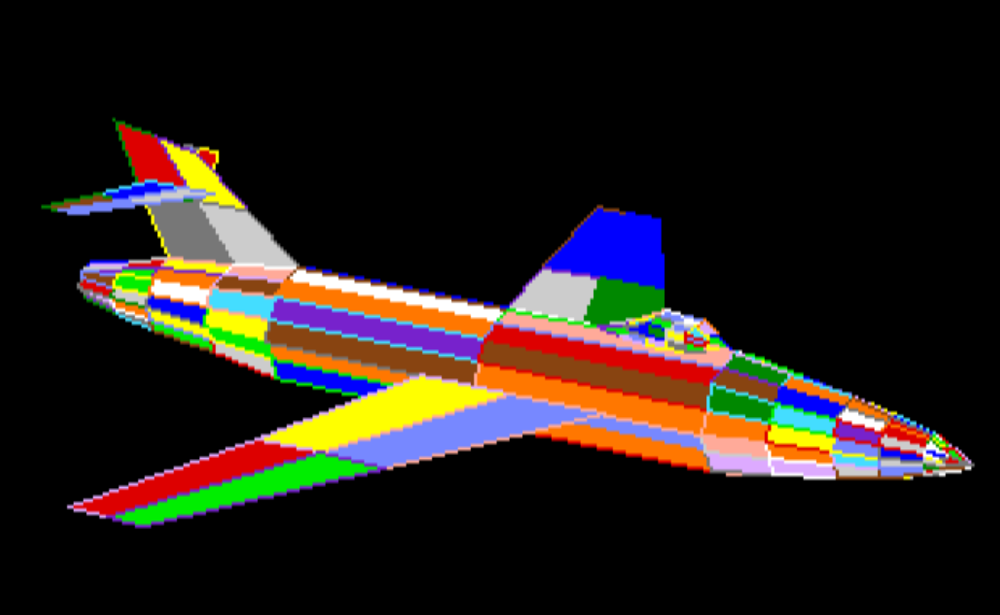

#### Diagnostic Tools
| Key | Action | Description |
|-----|--------|-------------|
| `V` | Show Face | Display single face (arrows to navigate); `N` toggles normal display; `Space` shows detailed textual info (ID, sorted position, orientation, hidden status, vertices, transformed 3D and 2D coords, plane equation), from which `F` saves to `Face<ID>.txt`, `V` reverses vertex order, `H`/`R`/`A` hide/restore/restore-all faces; any other key exits |
| `D` | Inspect Before | Analyze faces before selected face in sorted order (can apply moves with `A`/`O` during preview) |
| `S` | Inspect After | Analyze faces after selected face in sorted order (can apply moves with `A`/`O` during preview) |
| `Q` | Inspect Face Pair | Interactive face-pair inspector for ordering anomalies |
| `;` | Repair Face Order | Review and accept/skip exchanges proposed by the GEO V3 core |
| `(` | Select Overlap Method | Choose Simple, V1, V2 original, V2Max, Fixed64, Raster, or Raster ×10 |
| `I` | Toggle Inconclusive | Show/hide inconclusive face pairs with frames |
| `L` | Face ID Labels | Display face numbers centered on each polygon |
| `F` | Export Debug Data | Dump `Faces3D.csv`, `Faces2D.txt`, and `FacesOrder.txt` |

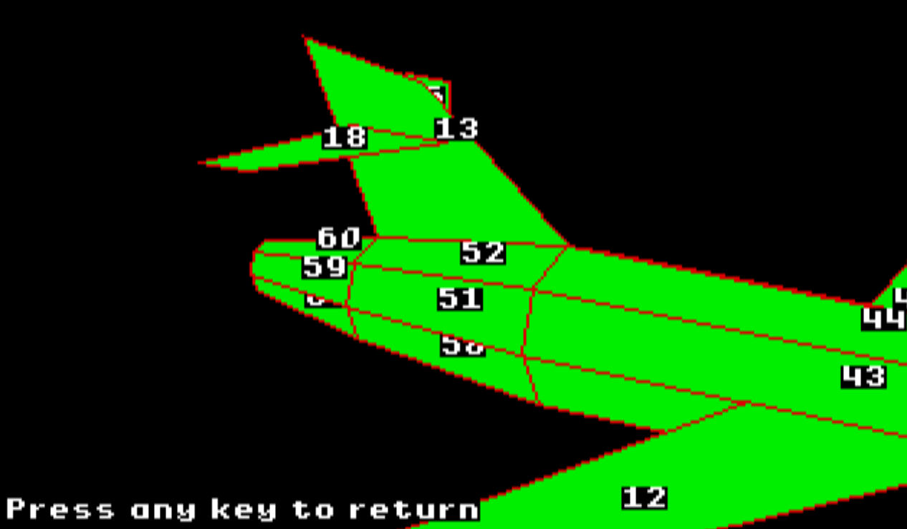


### Face Pair Inspector (`Q` key)

The `Q` key launches a dedicated interactive face-pair inspector for exploring ordering diagnostics.

- Prompts separately for two face IDs; displays the model in wireframe with the first face in green and the second in orange.
- Compares bounds, shared geometric face relations, and the selected projected-overlap method. Ray diagnostics use bounding-box, Sutherland-Hodgman (SH), and QuickDraw overlap sample points, including a ×10 diagnostic pass. SH denotes polygon clipping, not the SHGR screen mode.
- Arrow keys navigate between pairs; `Space` opens the detailed textual results and `ESC` returns from the graphical inspector.
- In the detailed screen, `R` moves the currently earlier face later in the draw order; `E` moves the currently later face earlier. These are stable moves, not an automatic proof of geometric correctness. `F` exports comparison results.
- Temporary display and culling settings are restored when leaving the inspector.

### Face Order Repair (`;` key)

The `;` key runs `repair_geov3`. It shares the GEO V3 ordering engine and standard geometric helpers, while preserving the current face order as its starting point: it does not reset to canonical IDs or rerun the initial maximum-depth sort.

- Only pairs accepted by the configured projected polygon-overlap test are proposed, including in automatic mode. Overlapping bounding boxes alone are insufficient.
- Each proposal clears the screen and redraws the complete wireframe model, highlighting the affected faces in green and orange.
- The prompt states the intended draw-order change: **`Draw face 13 in front of face 18?`** The operation exchanges the two positions; it does not reverse vertex winding or modify geometry.
- `N` skips the current proposal. `ESC` stops and retains previously accepted changes. `Return` accepts the current proposal and continues automatically. Any other key accepts only the current proposal.
- The final summary reports proposed, applied, and skipped exchanges. View state is restored on exit.
- Like GEO V3, this is a bounded correction heuristic; intersecting faces and cyclic visibility may remain unresolved. The old centroid-based repairs are archived in disabled code in `old/chutier.c` and are no longer active commands.

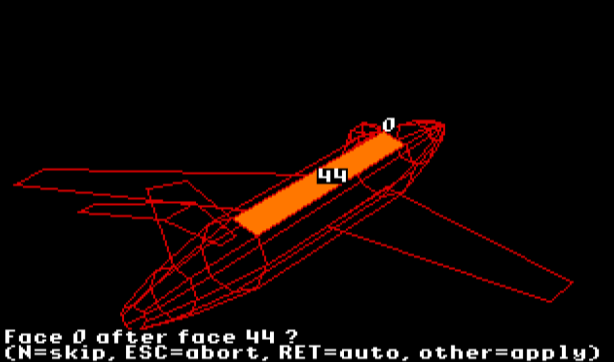
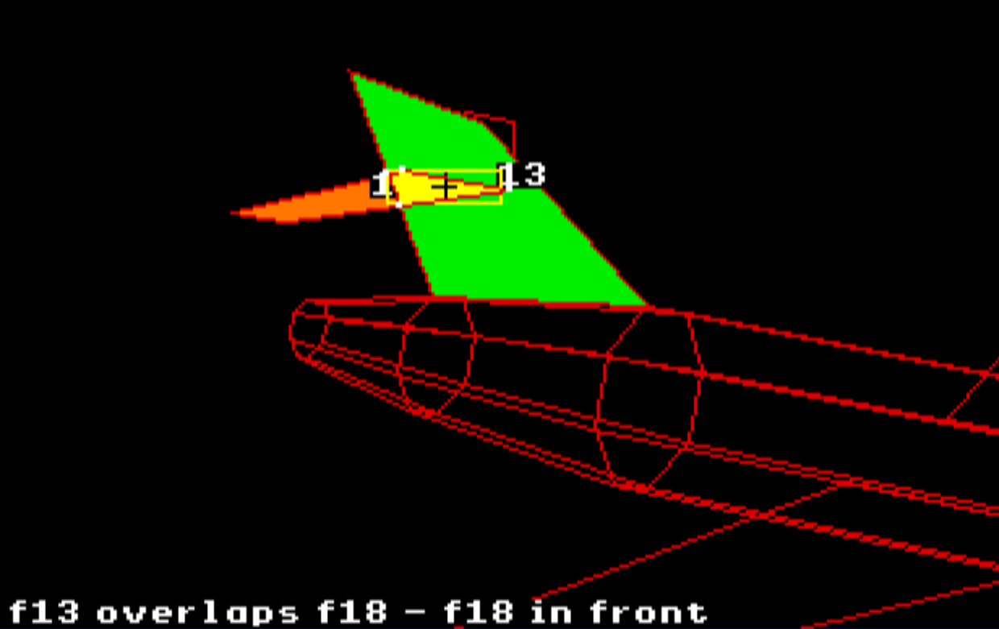
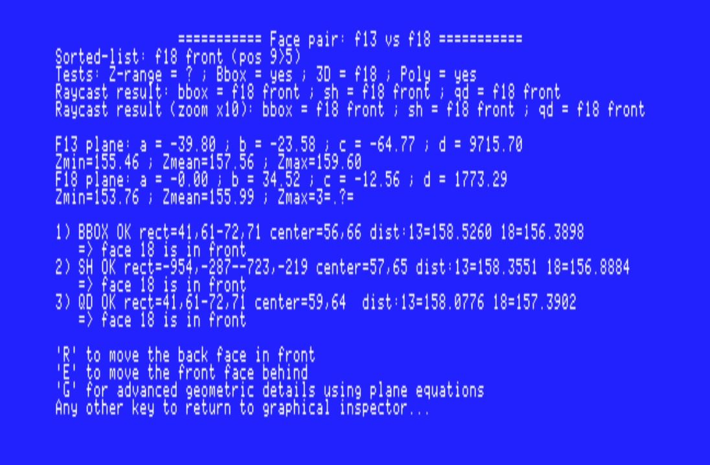

#### Navigation
| Key | Action | Description |
|-----|--------|-------------|
| `Space` | Model Info | Display vertices, faces, camera params, performance |
| `N` | New Model | Load different OBJ file (resets to FAST mode) |
| `H` | Help | Show paginated keyboard reference |
| `*` | Save Screenshot | Save the current SHGR screen to disk as a native Apple IIGS Super Hi-Res picture (see "Screenshot Export" below) |
| `ESC` | Quit | Exit application |

### Screenshot Export (`*` key)

Saves the current SHGR display to disk as an uncompressed native picture file, readable by GS/OS paint/viewer software (verified with CiderPress II):

- **Filename**: auto-incrementing `screenNNN.PIC` (e.g. `screen000.PIC`, `screen001.PIC`, ...) — the program scans the current directory and picks the first unused index, up to `screen999.PIC`. Existing readable files are skipped; no screenshot is saved if all 1,000 names are occupied.
- **Format**: raw (uncompressed) Super Hi-Res picture — 32000 bytes of pixel data, 256 bytes of Scan Control Bytes (200 real entries + 56 reserved padding bytes), and 512 bytes of color table data (16 palettes × 16 colors), matching the documented Apple IIGS SHGR memory layout exactly.
- **ProDOS file type**: `$C1`, auxtype `$0000` ("Apple IIGS Super Hi-Res Graphic Screen Image" — the plain format matching this project's 16-shared-palettes-plus-per-scanline-SCB architecture, not the different $0002 "3200 colors" per-scanline-palette format).
- `saveSHGRAsRawPic` copies the 32,768-byte screen region byte by byte through the target memory-model pointer and writes it with `fputc`, then assigns the ProDOS file metadata.
- Works after any renderer — painter, scanline Z-buffer, full-screen offscreen Z-buffer after its flush, or direct onscreen full-screen Z-buffer — since it simply captures whatever is currently in SHGR video memory.

### Workflow Example

**Typical Debugging Session:**

1. **Load Model** with `N` key
2. **Position Camera** using arrow keys and `A`/`Z`
3. **Customize Colors** (optional):
   - Press `8` for random colors (quick)
   - Press `>` to choose a specific fill color
   - Press `<` to choose a specific frame color
   - Press `9` to reset to defaults
4. **Select Rendering Mode** (`1`-`7`) based on geometry complexity.
5. **Enable Inspection** with `I` to see inconclusive pairs
6. **Investigate Artifacts**:
   - Press `V` to view individual faces
   - Use `D` to inspect faces before problematic face (in preview press `A` to consider all candidates or `O` to keep overlapping candidates)
   - Use `S` to inspect faces after (in preview press `A` to consider all candidates or `O` to keep overlapping candidates)
7. **Adjust View** with `E`/`R`/`T`/`Y`/`+`/`-` for precise framing
8. **Export Data** with `F` for external analysis

### Face Inspection Mode

When using `D` (Inspect Before) or `S` (Inspect After):

1. **Enter Face ID**: Type the face number to inspect
2. **Orange/Pink Faces**: System highlights potentially misplaced faces
3. **Interactive Moves**:
   - Press `A`: Use all highlighted candidate faces to choose the selected face's new position
   - Press `O`: Restrict candidates to faces with **projected overlaps**
   - Press any other key at the move prompt: Cancel without changes

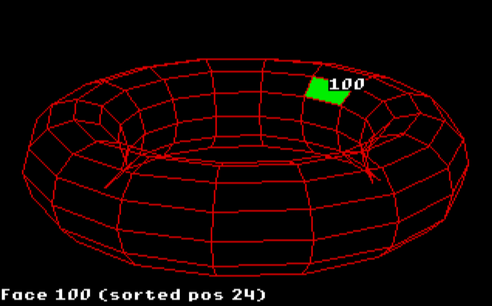

Both directions share `inspect_faces_order`: `D` moves the selected face before the earliest retained candidate; `S` moves it after the latest retained candidate. The highlighted faces are not individually relocated. Geometric explanations use the same adaptive face-relation tests as the decisions.

### Single Face Viewer (`V` key)

- **Left/Right Arrows**: Navigate by face ID (decrement/increment)
- **Up/Down Arrows**: Navigate through sorted face array
- **N**: Toggle display of the selected face's normal (drawn as a fixed-length screen-space segment from the face centroid; works even when the face is hidden, using its saved vertex count)
- **Space**: Show detailed textual info about the current face:
  - ID and position in the sorted list
  - Orientation (`FRONT`/`BACK`) and hidden status (`HIDDEN`/`NOT HIDDEN`)
  - Vertex count and per-vertex data: index, model-space coordinates (x,y,z), observer-space coordinates (xo,yo,zo), and projected 2D coordinates (x2d,y2d) — shown even when the face is hidden, using its saved vertex count
  - Plane equation coefficients `(a, b, c, d)`
  - From this screen: `F` saves the details to `Face<ID>.txt`, `V` reverses the face's vertex order, `H` hides the face, `R` restores it, `A` restores every hidden face in the model, any other key returns to the graphical overlay
- **Any Other Key**: Exit viewer and return to full model

**Hide/Restore:** hiding a face (`H`) sets its vertex count to zero without discarding its geometry (the original count is saved internally), so the face stops being rendered and is treated as hidden by geometry-dependent operations, while remaining selectable and shown in gray in the viewer. `R` restores the currently selected face and recomputes its plane/visibility (the model may have rotated while hidden). `A` restores every hidden face in the model in one pass.

Useful for examining individual face geometry and understanding the sorting order.

---

### Summary: Keys → C Functions Called 🔧

Below is a summary table of the most useful keys and the **C functions** they invoke (directly or via flags/modes). This helps map interactive behavior to code entry points when debugging:

| Key | Action (short) | C functions involved (entry point) |
|-----|-----------------|-----------------------------------------|
| `1`..`7` | Change painter mode | `painter_newell_sancha_fast`, `painter_bubble_sort`, `painter_newell_sancha`, `painter_geoV2`, `painter_geoV3`, or shared `painter_correct` (variant flag 0/1) |
| `O` | Optimized scanline Z-buffer render | `renderModelScanlineZBuffer` |
| `U` | Full-screen Z-buffer via offscreen buffer | `Offscreen_Clear` → `renderModelFullscreenZBuffer_offscreen` → `Offscreen_FlushToScreen` |
| `Open-Apple + U` | Full-screen Z-buffer directly onscreen | `renderModelFullscreenZBuffer` |
| `/` | Precompute and play horizontal rotation | `animate_model_rotation` in `animation.c`, included by `engine.c` |
| `>` | Choose fill color | `colorChooser(0, &palette, ...)` — sets `user_fill_color`; also triggers `generate_random_colors` if random is chosen |
| `<` | Choose frame color | `colorChooser(1, &palette, ...)` — sets `user_frame_color`; also triggers `generate_random_colors` if random is chosen |
| `8` | Random fill colors | sets `user_fill_color` to random mode + `generate_random_colors`; keeps frame selection |
| `9` | Reset colors, palette, shading | resets `user_fill_color`/`user_frame_color`, `palette`, `shaded_by_orientation` |
| `G` | Cycle color palette | increments `palette` (mod 16) + `applyPalette` |
| `!` | Toggle orientation shading | `shaded_by_orientation` toggle + `computeOrientationShading` |
| `V` | Inspect a face | `showFace` — submenu `Space`: `V` (reverse vertex order), `H`/`R`/`A` (hide/restore/restoreAll), `F` (export) |
| `*` | Save screen | `saveNextScreenshot` → `saveSHGRAsRawPic` ($C1/$0000 format, auto-incremented name `screenNNN.PIC`) |
| `A` / `Z` | Adjust camera distance | modifies `params.distance` and reloads the render |
| `E` / `R` / `T` / `Y` | 2D panning | modifies `pan_dx` / `pan_dy` and redraws |
| `B` | Toggle back-face culling | `cull_back_faces` + reprocess model |
| `P` | Wireframe mode | `framePolyOnly` + redraw / reprocess |
| `C` | Color palette overlay | `colorpalette` toggle |
| `J` | Render jitter | `jitter` toggle |
| `K` | Edit angles/distance | `getObserverParams` |
| `D` / `S` | Inspect faces before / after | `inspect_faces_order(model, &params, 0)` / `inspect_faces_order(model, &params, 1)` |
| `Q` | Inspect face pair | `inspect_face_pair_ui` |
| `;` | Interactive repair | `repair_geov3` → `geov3_run` with confirmation callback |
| `(` | Select overlap method | Runtime overlap-method selection |
| `F` | Debug CSV export | `dumpFaceEquationsCSV` + `dumpFace2DCoordinates` + `dumpSortedFaceIndices` |
| `N` | Load new model | `destroyModel3D` + model creation/loading; resets FAST mode and initial view settings |
| `H` | Paged help | `show_help_pager` |
| `ESC` | Exit | cleanup + exit |

> Note: Some commands invoke multiple utilities (e.g., `F` writes `Faces3D.csv`, `Faces2D.txt`, and `FacesOrder.txt`). To investigate specific behavior, start by using the corresponding key in the interface, then consult the output files (`Faces3D.csv`, `Faces2D.txt`, `FacesOrder.txt`, `Face<ID>.txt`) to reproduce/automate tests.

---

## File Format

3D Explorer reads simplified Wavefront OBJ files. This minimal example contains four vertices and two faces:

```obj
# Vertex definitions (x y z)
v 0.0 0.0 0.0
v 1.0 0.0 0.0
v 1.0 1.0 0.0
v 0.0 1.0 0.0

# Face definitions (vertex indices, 1-based)
f 1 2 3 4
f 1 3 4
```

**Requirements:**
- Only `v` (vertex) and `f` (face) lines are parsed
- Vertex indices in faces are 1-based (OBJ standard)
- Faces can be triangles, quads, or polygons up to `MAX_FACE_VERTICES` (currently 16); input and storage limits still apply
- Comments (`#`) are ignored

**Unsupported OBJ features:**
- Texture coordinates (`vt`)
- Normals (`vn`)
- Materials (`mtllib`, `usemtl`)
- Groups (`g`)


## Building from Source

**Requirements:**
- Apple IIGS with ORCA/C 2.2.1 or later
- Golden Gate development environment

**Compilation:**
```bash
iix compile ObjExplorer.cc
iix -DKeepType=S16 link OBJExplorer keep=OBJExplorer
```

**Deployment:**
`DEPLOY.py` automates compilation, linking, updating configured disk images, and optional Android transfer for KEGS. Its local paths, Cadius setup, image destinations, and ADB configuration must match your machine. Unlike the compile/link commands above, it modifies disk images and may deploy to a connected device:
```bash
python DEPLOY.py
```

## Implementation Notes

### Memory Management

- **Model Storage**: Current constants allow 6,000 vertices, 6,000 faces, and 16 vertices per face. Allocation and index-buffer limits also apply; these constants do not guarantee that every combination fits.
- **Model Lifetime**: Creation initializes the owner structure to zero and retains the existing array allocation sizes and order. Allocation failures reuse `destroyModel3D` to release every completed allocation once; the same destructor handles fully loaded models and their caches. Only the owner structure is cleared, not the large data arrays.
- **Handle-Based Graphics**: QuickDraw polygons and inspection tools share a maximum-capacity polygon handle and point construction expanded at compile time, while retaining their existing bounding-box, clipping and pen-state rules. Saved screen/view state is shared by inspection tools.
- **Z-Buffer Scratch Storage**: Common reservation/free helpers manage prepared vertices and faces; renderer-specific buffers retain their own storage requirements and allocation checks.
- **Memory Model**: `#pragma memorymodel 1` selects the target's large memory model with far pointers. Available RAM remains a practical limit.

### Code Organization

- **Entry Point**: `ObjExplorer.cc` owns startup, keyboard dispatch, mode selection, and the main render loop. It includes `engine.c`, which includes the supporting modules; they are built as one translation unit.
- **Geometry and Ordering**: `engine.c`, `declare.c`, `ordering_cache.c`, `dony.c`, and `overlap_raster.c` hold structures, transforms, sorting, relation tests, and overlap implementations. `geo_relation_asm.c`, `face_depth_asm.c`, and `dony_scan_asm.c` supply specialized 65C816 kernels.
- **Rendering**: `color.c` manages palettes and color selection. `zbuffer_common.c` shares preparation and span rendering across `zbuffer_scanline.c`, `zbuffer_fullscreen.c`, and `zbuffer_fullscreen_offscreen.c`. `screen_save_restore.c` shares screen/view support.
- **Inspection**: S/D, Q, V, repair, and face labels share inspection-state save/restore helpers. The old pair-debug mode has been removed; normal inspection and file exports remain.
- **Animation**: `animation.c`, included at the end of `engine.c`, owns temporary frame handles and compiled direct-video transitions; the `ANIM` segment keeps the command separate from rendering kernels.
- **Segments**: Named segments such as `transform`, `ordering`, `rendering`, `inspection`, and `ZBUF` organize target memory banks. `#pragma optimize 1` enables compiler optimization.
- **Companion Documentation**: [dictionary.md](dictionary.md), [call tree](arbre_appels.html), and [foldable call tree](arbre_appels_fold.html) describe the current functions and call relationships in French.

### Coordinate Systems

1. **Model Space**: Imported OBJ coordinates with Y/Z exchanged and bounding-box centering applied
2. **Observer Space**: After camera transformation (xo, yo, zo)
3. **Screen Space**: 2D projected coordinates (x2d, y2d) + pan offsets

**Screen Origin**: (160, 100) represents center of 320×200 display

## Known Limitations and requirements 

- **Polygon Splitting**: Basic in‑memory splitting on load (faces cut by intersecting planes) now implemented to eliminate simple interpenetrations
- **Transparency**: Not supported; all polygons are opaque
- **Lighting**: Minimal shading model (use ! key to activate shading, in conjonction with palette # > 0)
- **Large Models**: Runtime depends on overlap density, face complexity, correction count, and hardware; there is no universal face-count threshold for acceptable speed.
- **Memory Constraints**: Model arrays, caches, and renderer scratch buffers must fit available Apple IIGS RAM. Full-screen depth alone consumes 128,000 bytes; offscreen pixels add 32,000 bytes. An accelerator or emulator is useful for demanding models.
- **Clipping and Geometry**: General near-plane clipping is not implemented. Degenerate/non-planar faces and intersections can defeat whole-face ordering; Z-buffer rendering resolves depth per pixel but still depends on valid projected geometry.

## Future Enhancements

- Improve and validate experimental polygon splitting, including degenerate geometry
- Profile shared ordering and rendering kernels on real Apple IIGS hardware
- Support textured polygons
- Extend the lighting model
- Optimize screenshot copying while preserving far-address correctness and the native file layout
- Improve clipping and robustness around the observer/near plane
- Expand regression models for cyclic overlaps, coplanar faces, concave polygons, and inspector/automatic-sort consistency

## Credits

**Author**: Bruno  
**Platform**: Apple IIGS  
**Development Tools**: ORCA/C 2.2.1, Golden Gate, iix

**Algorithm References**:
- "Calcul des parties cachées", Robert DONY, Masson, 1986*
- Newell, M.E., Newell, R.G., and Sancha, T.L. (1972). "A solution to the hidden surface problem"
- Painter's algorithm theory and implementation techniques

## License

This project is licensed under the **Creative Commons Attribution 4.0 International License (CC BY 4.0)**.

You are free to:
- **Share**: Copy and redistribute the material in any medium or format
- **Adapt**: Remix, transform, and build upon the material for any purpose, even commercially

Under the following terms:
- **Attribution**: You must give appropriate credit to the original author and a link to this repository.

### Disclaimer

This software is provided "as is", without warranty of any kind, express or implied. The author assumes no responsibility for any damages or issues arising from the use of this software. Use at your own risk.

---

For questions, bug reports, or contributions, please visit the project repository.
